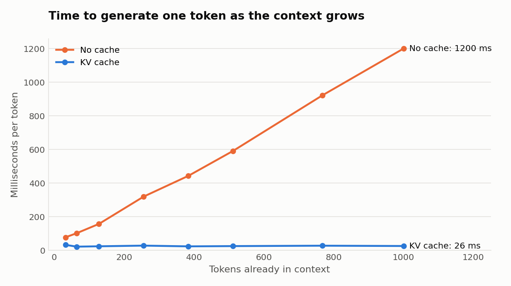
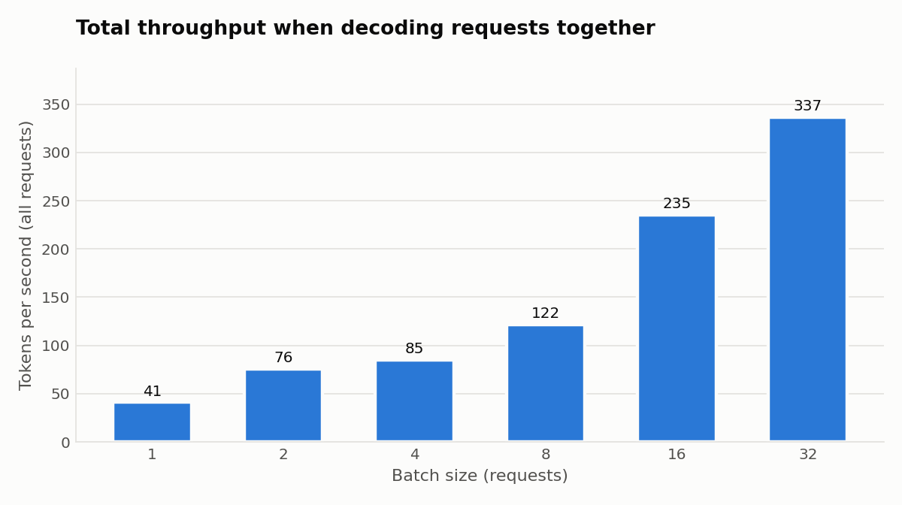
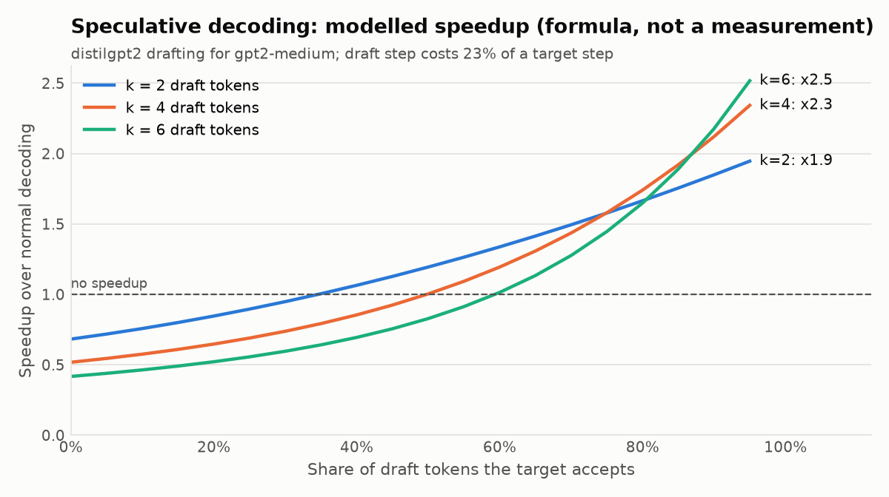

# LLM Inference from Scratch

GPT-2 inference written from the ground up in plain PyTorch, with the three techniques that make real LLM serving fast. Each one is implemented by hand, tested against the slow baseline, and benchmarked:

| Technique | What it fixes | Result (GPT-2 124M, 2 CPU threads) |
|---|---|---|
| **KV cache** | Re-computing attention over the whole history for every new token | Per-token time stays flat at **~25 ms** instead of growing to **1.2 s** at 1,000 tokens (**47×**) |
| **Batched decoding** | One request at a time leaves the hardware idle | **8.2×** more tokens/second at batch size 32 |
| **Speculative decoding** | Every token needs a full pass through the big model | Up to **1.7×** expected at 80% acceptance with a draft costing 23% of the target, **with identical output** |

No inference libraries are used: the model, attention masking, cache, batching and the speculative accept/reject rule are all in about 550 lines of core code under [`infer/`](infer). Hugging Face is used only to download trained weights and the tokenizer.

## Results

### KV cache: time per token no longer grows with context



Without a cache, generating each token re-runs the model over every previous token, so the cost grows linearly per token (quadratically in total). With the cache, keys and values of past tokens are stored once and only the new token is processed.

End to end, from a 16-token prompt:

| New tokens | Naive (tok/s) | KV cache (tok/s) | Speedup |
|---:|---:|---:|---:|
| 32 | 15.3 | 43.5 | 2.8× |
| 64 | 12.4 | 43.7 | 3.5× |
| 128 | 9.0 | 46.9 | 5.2× |
| 256 | 5.5 | 44.1 | 8.0× |

The gap widens with length: naive decoding slows down as text gets longer, while cached decoding holds steady.

### Batching: more requests for almost the same cost



Decoding one token is limited by reading the model's weights from memory, not by arithmetic. Processing 32 requests together reads the weights once for all of them, so total throughput rises from 41 to 337 tokens/second. Prompts of different lengths are left-padded, and a padding mask keeps padding out of both attention and position ids, so each request gets exactly the tokens it would get on its own (tested).

### Speculative decoding: several tokens per big-model pass



A small draft model (distilgpt2, 82M) guesses *k* tokens; the target model (gpt2-medium, 355M) checks all of them in **one** forward pass. Accepted guesses are free tokens. The accept/reject rule from [Leviathan et al. (2023)](https://arxiv.org/abs/2211.17192) guarantees the output follows the target model's distribution exactly, so speed improves with no change in quality.

The curves combine the measured cost of one draft step (23% of a target step on this machine) with the standard formula for expected accepted tokens. Two takeaways:
- Below ~50–60% acceptance it is **slower** than normal decoding; the draft has to agree with the target often enough to pay for itself.
- More draft tokens (larger *k*) only pay off when acceptance is high.

> Measured speculative results with trained weights: run `python -m infer.benchmark --pretrained` (see below). The acceptance rate depends on how well the two trained models agree, so it can't be measured with random weights.

## How it works

```
infer/
  model.py         GPT-2 (attention, MLP, blocks) with optional KV cache and padding mask
  kv_cache.py      preallocated K/V tensors; truncate() rolls back rejected tokens
  generate.py      naive, KV-cached and batched generation
  speculative.py   draft -> verify -> accept/reject -> roll back caches
  sampling.py      greedy, temperature, top-k, top-p
  weights.py       loads Hugging Face GPT-2 checkpoints into the from-scratch model
  benchmark.py     timing harness; writes results/benchmarks.json
  plots.py         charts in results/
tests/             correctness tests (run offline in seconds)
```

**KV cache.** Each layer writes the new token's keys and values into a preallocated buffer at position `length` and attends over `[0, length]`. `length` only advances after all layers have written, so every layer sees the same position. Preallocating means decoding never reallocates memory.

**Batching with padding.** Prompts are left-padded so every row's newest token sits in the same column. A boolean mask `[batch, seq]` marks real tokens; it is combined with the causal mask, and position ids are computed from the running count of real tokens so padding doesn't shift them. Each query may always attend to itself, which avoids an all-masked row (NaN) on padding positions.

**Speculative decoding.** Per round:
1. The draft generates *k* tokens with its own KV cache.
2. The target scores `[last token, d1 … dk]` in one pass, producing *k + 1* next-token distributions.
3. Draft token *i* is kept with probability `min(1, p(x) / q(x))`. At the first rejection, a replacement is sampled from `max(0, p − q)`, normalized. If all *k* pass, the target's last distribution gives a bonus token.
4. Both caches are truncated back to the accepted prefix.

With greedy decoding `p` and `q` are one-hot, so the same rule becomes "keep drafts while they match the target's top choice", and the output is **token-for-token identical** to normal greedy decoding. One code path handles both cases.

## Tests

```bash
pip install -e ".[dev]"
pytest
```

The tests check correctness, not just that code runs:
- Cached logits equal a full forward pass; cached, naive and batched generation give identical tokens.
- Speculative greedy output equals the target's own greedy output for *k* = 1, 3, 5, even with an unrelated draft model.
- **Speculative sampling reproduces the target's exact distribution:** the joint distribution of two sampled tokens over 6,000 runs matches the true probabilities (total variation < 0.05), using a draft that disagrees with the target most of the time. Three deliberately broken versions of the accept/reject rule each fail this test.
- Our model loaded with Hugging Face GPT-2 weights produces the same logits as Hugging Face's own implementation.

## Try it

```bash
pip install -e ".[hf,plots]"

# generate with real GPT-2 weights
python -m infer "The history of the printing press" --mode kv
python -m infer "The history of the printing press" --mode speculative --model gpt2-medium --draft distilgpt2

# run naive, KV cache and speculative on the same prompt and confirm identical output
python -m infer "Once upon a time" --mode compare --model gpt2-medium

# reproduce the benchmarks (random weights, no download) or with real weights
python -m infer.benchmark
python -m infer.benchmark --pretrained
```

Benchmarks were run on CPU with 2 threads (PyTorch 2.14). Absolute numbers depend on hardware; the relative effects are what matter. On a GPU the batching gains are much larger, because the hardware has even more unused compute per weight read.

## What I'd add next

- **Continuous batching:** let finished requests leave and new ones join mid-batch instead of waiting for the whole batch, as vLLM and TGI do.
- **Paged KV cache:** allocate cache in fixed-size blocks to avoid reserving memory for the maximum length up front.
- **Quantized weights:** int8 weights to cut the memory reads that dominate decoding.
